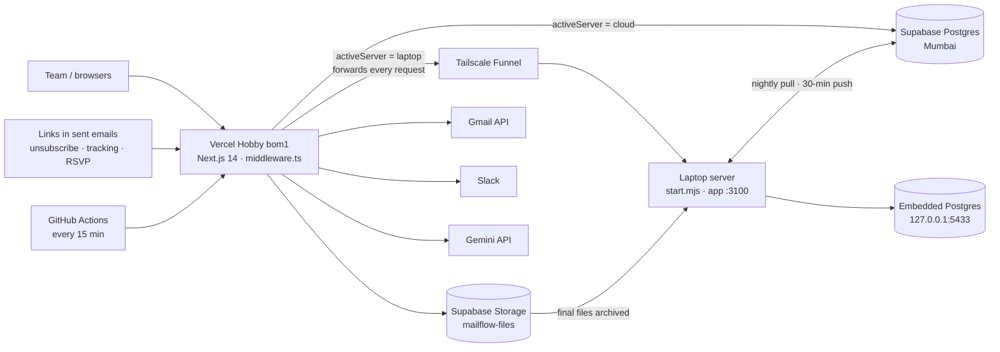
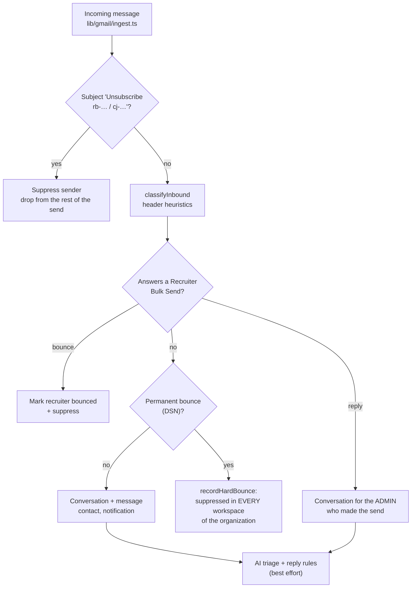
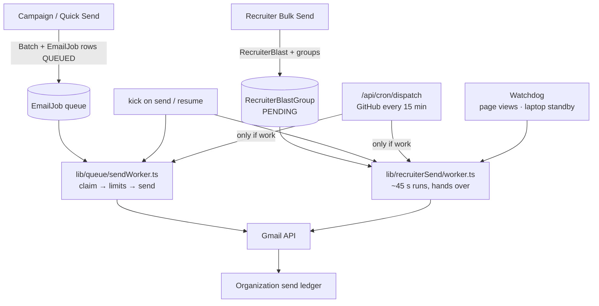
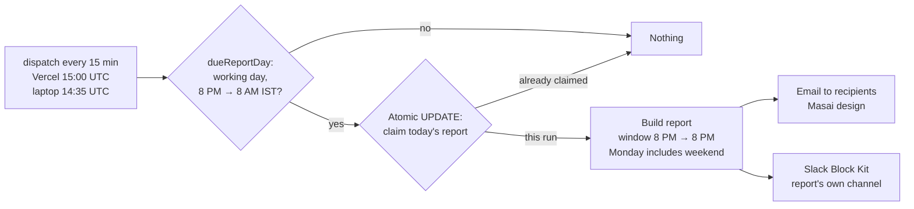

# MailFlow — Architecture

Internal Masai School communication / automation / CRM platform. This document
is the system design referenced by the implementation. It was written before
the code and is kept in sync as the code evolves. Last updated 2026-11-10.

## 1. System Architecture



- **Web app**: Next.js 14.2 (App Router, TS, Tailwind), Prisma 5. Server
  Components for read views; route handlers under `app/api/**` for every
  mutation, so the UI, the scheduled jobs and the tests call the same
  endpoints.
- **Hosting**: Vercel **Hobby**, functions pinned to Mumbai (`regions:
  ["bom1"]`) and Node `26.x` (`package.json` `engines`). `vercel.json`
  `ignoreCommand` runs `scripts/vercel-ignore.sh`. It skips a deployment when
  only `tests/`, `laptop-server/`, `.github/`, `docs/` or `*.md` changed,
  which saves Hobby deployment storage. When in doubt it builds.
- **DB**: PostgreSQL on **Supabase** (free plan, Mumbai) through Prisma
  (`lib/db/client.ts`). There is one database, tenant-scoped by
  `organizationId`/`workspaceId`. A full standby copy lives on the laptop
  server (§16).
- **Files**: signing attachments and signed PDFs go to Supabase Storage
  (private bucket `mailflow-files`, `storage:` refs) while in progress. Once
  final, the laptop archives them (`archive:` refs, §16). See
  `lib/storage/files.ts`.
- **No always-on workers in production.** Sending is a database queue drained
  by short serverless runs that hand over to fresh runs. GitHub Actions is the
  15-minute backstop (§9, §17). Redis/BullMQ (`lib/queue/queues.ts`,
  `workers/email-worker.ts`, `workers/automation-worker.ts`) is optional and
  only used when `REDIS_URL` is set. Both paths run the same per-job
  processor (`lib/email/processJob.ts`).
- **Google APIs**: the small per-API packages `@googleapis/gmail`,
  `@googleapis/sheets` and `@googleapis/people` (with `googleapis-common`).
  The full `googleapis` package is no longer used.
- **External services**: the Gmail API (send, history, optional Pub/Sub
  watch) and Gemini (AI, optional). Slack is used through a bot token
  (`SLACK_BOT_TOKEN`, `lib/slack/client.ts`).

## 2. Database ERD (textual)

```
Organization 1─* Workspace
Organization 1─* User
Workspace 1─* Contact
Workspace 1─* Dataset 1─* DatasetColumn
Dataset 1─* Record  (Record.data: jsonb, keyed by column id)
Record *─1 Contact (nullable; resolved by email match)
Workspace 1─* SavedView (scoped to a Dataset)
Workspace 1─* Template 1─* TemplateVersion
Workspace 1─* EmailProviderAccount (connected Gmail mailbox)
Workspace 1─* Campaign  (Quick Send is a Campaign too)
Campaign *─1 Template / TemplateVersion (snapshot)
Campaign *─1 Automation (nullable, if automation-triggered)
Campaign 1─* CampaignRecord
Campaign 1─* Batch 1─* EmailJob
EmailJob *─1 EmailProviderAccount (sender snapshot)
Workspace 1─* RecruiterBlast 1─* RecruiterBlastGroup (one Gmail message: a BCC group or one copy)
RecruiterBlast 1─* RecruiterBlastRecipient
Workspace 1─* EmailSuppression (unique per workspace + email)
Workspace 1─* Automation 1─* AutomationVersion 1─* AutomationRun
Contact 1─* Conversation 1─* ConversationMessage 1─* Attachment
Conversation 1─* InternalNote / FollowUp; *─* Tag
Workspace 1─* SigningRequest (e-signature documents)
Organization 1─1 IntegrationSettings (Slack + report / triage settings JSON)
Organization 1─* ProfilePhoto (one per address)
Organization 1─* AuditLog
Workspace 1─* AiUsage
SystemState (single row, cloud database only: the server switch)
```

Canonical identity rules:
- **Contact** identity key: `(workspaceId, lower(primaryEmail))`, unique.
  Record → Contact linking happens at import time by email match. Two
  existing Contacts are never auto-merged.
- **Conversation** identity key: `(emailProviderAccountId, gmailThreadId)`,
  unique, and never keyed by subject alone (§45/46). Recruiter Bulk Send
  replies are the one variation. With BCC every recruiter answers in the
  same Gmail thread, so the key is `<threadId>#<recruiter email>`: one
  conversation per recruiter (`lib/recruiterSend/replies.ts`).

## 3. Database Schema

Implemented in [`prisma/schema.prisma`](prisma/schema.prisma). Field-level
detail lives there; it is the source of truth. This doc only records the
relationship rules above and the indexing plan (section 99 of the spec),
which is applied via `@@index` / `@@unique` in that file. Migrations are
versioned (`prisma migrate`). The laptop applies them on start
(`prisma migrate deploy`).

## 4. Authentication Architecture

- NextAuth.js (Auth.js) with the Google provider only. No credentials
  provider is registered.
- The `signIn` callback rejects any account whose email domain is not
  `masaischool.com` (config: `ALLOWED_EMAIL_DOMAIN`), before a session or DB
  user is ever created.
- On first sign-in a `User` and a personal `Workspace` are created in the
  organization. Every bounce and complaint the organization already knows is
  then copied into the new workspace (`syncOrgBounces`, §8).
- Session strategy: database sessions (not JWT-only), so a role change or
  disable takes effect without waiting for token expiry.
- Every server entry point re-derives `{ userId, organizationId, workspaceId,
  role }` from the session (`lib/auth/session.ts`), **never** from a
  client-supplied body or query param.

Workspace model: there is one `Workspace` per `User`, with a
`WorkspaceMember` join table so a workspace can be shared. Inbox sharing
uses it. Super Admins get audited, read-only "View as" access to other
workspaces. "View as" is a signed, HttpOnly, 4-hour cookie
(`lib/auth/viewAs.ts`). `requireSession` resolves it into `session.workspaceId`
plus `session.viewingAs`, after re-checking on every request that the
workspace is in the admin's organization. `requireCanWrite` refuses
mutations while `viewingAs` is set.

## 5. Gmail OAuth Architecture

- OAuth consent is separate from login. Signing in grants identity only.
  Connecting Gmail (Settings → Gmail → Connect) is a distinct step that asks
  for `GMAIL_SCOPES` (`lib/gmail/oauth.ts`):
  - `gmail.send`
  - `gmail.readonly` (thread/message fetch for sync and threading headers)
- Further scopes are requested incrementally, only when a feature needs them:
  - `spreadsheets` for Google Sheets sync (`SHEETS_OAUTH_SCOPE`);
  - `contacts.other.readonly` for profile photos and names
    (`PHOTOS_OAUTH_SCOPE`, opt-in per mailbox, §19).
- Tokens are stored in `EmailProviderAccount`. The refresh and access tokens
  are **encrypted at rest** with AES-256-GCM using `ENCRYPTION_KEY`
  (`lib/crypto/secretBox.ts`). They are never sent to the browser.
  `authorizedClientFor` in `lib/gmail/oauth.ts` refreshes and re-encrypts.
- Sending "as" a user requires that user's own grant, never impersonation
  (§10). A teammate's mailbox can carry a send only when it was shared as a
  backup/fallback mailbox and is connected.

## 6. Gmail Threading Architecture

- Every outbound send stores `gmailMessageId`, `gmailThreadId`, and the RFC
  `Message-ID` header.
- **First message**: no `threadId` is passed to `users.messages.send`; Gmail
  creates one and we record it.
- **Reply / continue conversation**: pass the stored `gmailThreadId` and set
  `In-Reply-To` / `References` to the prior message's `Message-ID`, so every
  client threads correctly.
- A `Conversation` row is the durable identity.
  `Conversation.gmailThreadId` is nullable until the first message confirms
  it.

## 7. Gmail Inbound Sync Architecture

`lib/gmail/sync.ts` has two paths that feed the same `ingestInboundMessage`
(`lib/gmail/ingest.ts`), so what is stored doesn't depend on the path:

- **Scheduled sync (always on):** `/api/cron/gmail-sync` syncs every
  connected mailbox. GitHub Actions calls it every 30 minutes; it also runs
  every 15 minutes on the laptop when active, and once a day as a Vercel
  cron backstop. It uses `users.history.list` from the stored `historyId`.
  When there is no history id, or the history has expired, it falls back to
  a bounded scan of recent INBOX + SENT.
- **Push (optional):** only when `GMAIL_PUBSUB_TOPIC` is set. Gmail notifies
  Pub/Sub, which POSTs to `/api/webhooks/gmail`, which syncs that mailbox at
  once. A watch lasts 7 days and is renewed from the scheduled sync when
  less than a day is left (`lib/gmail/watch.ts`).
- **Triage before fetch (busy mailboxes, §104):**
  - drafts, spam and trash are dropped from the history labels without a
    fetch;
  - ids already stored are dropped in one query;
  - only messages in MailFlow threads, from known contacts, or answering a
    MailFlow / recruiter-send Message-ID are fetched in full.
  
  Unrelated personal mail is never imported.
- **Sync Now** on each mailbox runs the same code by hand.

## 8. Reply, bounce and unsubscribe ingest



- **Unsubscribe by email** (`lib/email/unsubscribeByEmail.ts`). A short
  email to the sending mailbox with the subject `Unsubscribe rb-<token>`
  (recruiter send) or `cj-<token>` (campaign email) suppresses the sender.
  A plain "Unsubscribe" also counts. It is the only way a BCC email can
  tell who unsubscribed.
- **Recruiter replies** (`lib/recruiterSend/replies.ts`) are matched by the
  Message-ID they answer, from any mailbox in the organization since
  Reply-To can point elsewhere, or by the send's Gmail thread. They belong to
  the admin who made the send: their workspace, assigned to them. This holds
  even when a teammate's backup mailbox carried the email; that mailbox's
  owner doesn't see it. The recruiter is marked "replied" on the send's page.
- **Bounces** (`lib/email/bounces.ts`):
  - Gmail usually accepts the message and a Delivery Status Notification
    arrives later. `parseBounce` reads the common formats.
  - Only permanent failures suppress. A hard bounce from any tool
    (campaign, Quick Send, Recruiter Bulk Send) by any user is suppressed in
    **every workspace of the organization** (`recordHardBounce`).
  - `syncOrgBounces` fills the gaps: on sign-up, and daily from the
    daily-report cron.
  - Unsubscribes stay per workspace, because they are a choice about that
    sender.
- **Inbox replies** check suppression too. `POST
  /api/conversations/[id]/reply` refuses to answer an address that
  hard-bounced or complained (`lib/email/replySuppression.ts`).
- Reply classification uses header heuristics first (`Auto-Submitted`,
  `X-Autoreply`, mailer-daemon patterns). AI intent and triage
  (`lib/ai/triage.ts`) run afterwards, best effort, per organization
  settings.

## 9. Sending Architecture

Two senders, both pull-based from the database and safe to run concurrently
(every message is claimed before it is sent):



**Campaigns and Quick Send** (`lib/queue/sendWorker.ts`, `lib/queue/drain.ts`):
- Campaign emails wait as `QUEUED` `EmailJob` rows. A send, resume or retry
  calls `kickSendWorker`, and the worker keeps calling itself in fresh
  invocations while work remains, so the tab can be closed. An open campaign
  page and the 15-minute dispatch are the backstops.
- Before every send the per-mailbox limits are recounted
  (`wouldExceedDaily`):
  - `EMAIL_DAILY_LIMIT` messages, default 1,500 and never above 1,900;
  - 1,800 unique recipients;
  - 9,000 total recipients per 24 h.
  
  The per-minute rate is `EMAIL_RATE_LIMIT_PER_MINUTE`. Gmail back-off pauses
  a mailbox.
- A job left `SENDING` by a crash is checked against the mailbox's Sent
  folder before it is re-queued (`recoverStuckJobs`), so nobody gets it
  twice.
- Idempotency: `EmailJob` is unique per `(campaignId, recordId,
  templateVersionId)`. Permanent failures are marked `FAILED` without retry.
  Pause, resume and cancel act at the `Batch` level.

**Recruiter Bulk Send** (`lib/recruiterSend/*`) sends BCC groups (one
message, `groupSize` addresses) or individual copies. Each send chooses
mailboxes (`accountIds`, in order), optional per-mailbox caps
(`accountLimits`), a pause (`gapSeconds`) and a `sendOrder`:
- **PARALLEL** (default): every chosen mailbox sends at once, in rounds.
  Each mailbox waits its own pause since its last email, and up to
  `MAX_PARALLEL` (5) messages go out together. Every batch has a planned
  mailbox; a mailbox that can't send hands its batches on.
- **SEQUENTIAL**: one message at a time with the send's pause, from the
  first chosen mailbox that can send, until its limit. Then the next mailbox
  takes over.
- **Failover**: a mailbox that is disconnected, paused by Gmail, at its
  daily limit (shared with campaigns) or at its cap for this send is
  skipped, and the next takes over. Why a send is waiting shows on its page
  (`note`).
- **Claims**: a message goes `PENDING → SENDING` before it is sent, so two
  runs can't send it twice. One left `SENDING` by a crash is never re-sent
  automatically; it may already be out. It is marked failed with a note to
  check the Sent folder.
- **Runs**: each run takes about 45 s, then hands over to a fresh one
  (`kickRecruiterWorker`). The 15-minute dispatch is the backstop.
- **Watchdog**: `nudgeStuckSends` restarts any `SENDING` send that hasn't
  sent or claimed anything for its pause + 75 s. It runs when someone views
  the send pages and from `/api/cron/recruiter-watchdog`. The laptop calls
  that route only after finding a stuck send in the cloud database itself
  (§16).
- **Personalisation** (`lib/recruiterSend/personalize.ts`), individual
  copies only:
  - `{{Column}}` takes each recruiter's value from the pasted or uploaded
    list. Names match loosely, and `Email`, `Name` and `First name` always
    exist.
  - `{{Column | fallback}}` covers empty values. With no fallback, a
    recruiter with an empty value is skipped and shown at the pre-send check,
    so a broken link never goes out.
  - Values are HTML-escaped; links stay exact inside `href`.
- Large messages (videos) go through Gmail's upload endpoint.

## 10. Unsubscribe

Every bulk email (campaign, Quick Send, Recruiter Bulk Send, BCC included)
carries an Unsubscribe button and `List-Unsubscribe` headers
(`lib/email/mime.ts`):
- **Personal emails** (campaign emails, individual recruiter copies): an
  https link that names the person, plus `List-Unsubscribe-Post:
  List-Unsubscribe=One-Click`, so Gmail's own button unsubscribes in one
  click (`/unsubscribe`, `/api/unsubscribe`).
- **BCC emails** are one message for many people, so a link can't say who
  clicked. They carry a `mailto:` to the sending mailbox (`rb-` code) and are
  **not** marked one-click. The unsubscribe arrives as an email and is
  handled by ingest (§8). The button's https link
  (`/unsubscribe/list/<token>`) opens a page where people enter their
  address.

## 11. Scheduled jobs

Vercel Hobby only allows daily crons, so the product cadence comes from
GitHub Actions (`.github/workflows/follow-up-reminders.yml`, workflow
`scheduled-jobs`). It calls the same `CRON_SECRET`-protected endpoints every
15 minutes:

| Cadence (GitHub) | Endpoint | What it does |
| --- | --- | --- |
| every 15 min | `/api/cron/dispatch` | Starts the campaign or recruiter sender only if there is work. After 8 PM IST on working days, it also sends the daily report if it hasn't gone out. |
| every 30 min | `/api/cron/gmail-sync` | Syncs every connected mailbox; renews push watches; refreshes profile photos weekly. |
| hourly | `/api/cron/follow-ups`, `/api/cron/sheets-sync` | Follow-up reminders; Google Sheets sync. |

Each step is independent (`continue-on-error`), and the senders run first.

A scheduled campaign's emails are created as `QUEUED` jobs when it is
scheduled, so `dispatch` sees them and starts the sender, and the sender's
`activeBatches` skips the campaign until `scheduledAt` passes and then flips
it to `RUNNING`. Scheduled campaigns therefore start within about 15 minutes of
their time; the daily `scheduled-send` cron is only a backstop.

Daily Vercel crons (`vercel.json`, UTC) are the backstops and the daily jobs:

| UTC | IST | Endpoint |
| --- | --- | --- |
| 00:00 | 05:30 | `scheduled-send`, `scheduled-replies` |
| 03:00 | 08:30 | `gmail-sync` |
| 03:15 | 08:45 | `sheets-sync` |
| 03:30 | 09:00 | `follow-ups`; Mondays also `weekly-report` |
| 03:45 | 09:15 | `send-queue` |
| 08:00 | 13:30 | `sla-check` |
| 09:00 | 14:30 | `signing-reminders` |
| 15:00 Mon–Fri | 20:30 | `daily-digest` (the 8 PM report; the backstop after the 15-minute dispatch) |
| 20:30 | 02:00 | `housekeeping` (deletes notifications > 90 days, audit entries > 365 days, finished webhook deliveries > 30 days, expired sessions; warns super admins when the database passes 350 MB or storage 700 MB; `lib/retention/housekeeping.ts`) |

When the laptop is the active server, it runs the same jobs on its own
timetable (§16) and Vercel crons are not forwarded to it.

## 12. Reports



- **Daily report**, 8 PM IST, Monday to Friday (`lib/digest/*`). It
  replaced the old 09:00 "needs attention" digest.
  - The window runs from 8 PM of the previous working day to 8 PM.
    Monday's report also carries Friday after 8 PM, Saturday and Sunday, each
    as its own segment.
  - It shows what was sent, by type, user and mailbox, from the
    Organization ledger. It also shows each person's inbox: replies, pending,
    closed, and first and average response times. Rows that are all zero are
    left out.
- **Once per day, from any caller**: `dispatchDailyReport` claims the day in
  the database with one atomic UPDATE before sending. The GitHub dispatch,
  the Vercel cron and the laptop can all try without sending twice. A late
  run still catches up until 8 AM the next morning.
- **Weekly report**, Monday morning (03:30 UTC = 09:00 IST). It covers last
  week Monday to Sunday, day by day against the week before, in the same
  design.
- **Slack**: both reports post Block Kit messages (`lib/slack/client.ts`)
  under their own name and icon. Each goes to its own channel
  (`digest.slackChannel` / `weeklyReport.slackChannel` in
  `IntegrationSettings.settings`; empty means the notifications channel).
- **Tests**: a test goes to one address, or to Slack marked `[Test]`. It
  never touches the once-a-day marker.
- Configured in System Settings → Reports & triage.

## 13. Automation Architecture

- `Automation` → `AutomationVersion` (immutable once any run references it,
  §73) → trigger + condition tree + ordered actions.
- Record writes (`app/api/datasets/[id]/records/**`, `app/api/records/[id]`,
  `lib/records/systemUpdate.ts`) call `onRecordChanged` in
  `lib/automation/runner.ts`. The runner re-checks the condition tree against
  fresh record state and applies the frequency policy (§37). It writes an
  `AutomationRun` row either way, then queues emails as normal `EmailJob`s.
- `WAIT` steps need the optional Redis queue (`enqueueAutomationEval`).
  Without `REDIS_URL` the run records the wait as skipped.
- Enabling an automation shows the §74 dry-run count first.

## 14. AI / Gemini Architecture

- **One provider seam.** `lib/ai/types.ts` defines `AIProvider` (§83), and
  `lib/ai/gemini.ts` is the only implementation. It calls the Generative
  Language REST API directly (no SDK) and asks for JSON via a response
  schema. It owns timeouts, retries, 429 handling and fallback models
  (`GEMINI_FALLBACK_MODELS`).
- **One policy seam.** `lib/ai/service.ts#runAiFeature` is the only way the
  app invokes a provider. It checks `AI_ENABLED`, key presence and the
  per-user and per-organisation daily limits (`lib/ai/limits.ts`, IST days).
  It logs an `AiUsage` row either way and maps every failure to `{ ok: false,
  code, message }`; nothing upstream sees an exception (§82). The count query
  spells out `errorReason: null`, because Prisma `notIn` excludes NULLs.
- **Minimum context (§81).** `lib/ai/prompts.ts` builds prompts from
  minimised input:
  - the last 8 turns;
  - quoted tails and signatures stripped;
  - addresses and phone numbers redacted;
  - first names only.
- **Suggestions, and opt-in triage.** Composer outputs land behind an
  explicit Insert or Apply. Inbox triage (`lib/ai/triage.ts`) can tag,
  assign, close thank-yous and draft an answer. It is per-organization,
  switched on in System Settings, and best effort.
- **Endpoint.** `POST /api/ai` with a discriminated `action`. `GET /api/ai`
  reports enabled, model and usage.

## 15. Multi-Tenant Security Model

- Tenant data carries `organizationId` and usually `workspaceId`. Every route
  derives the scope from the session (`requireSession()` /
  `requireRole([...])` in `lib/auth/*`) and filters by it explicitly. Access
  to conversations goes through `lib/conversations/access.ts`, which
  includes workspace sharing.
- `requireRole` throws a typed `ForbiddenError`, and the route returns 403.
  UI hiding mirrors the check but never replaces it.
- SUPER_ADMIN cross-workspace reads go through "View as" (read-only, audited
  in `AuditLog`). The Super Admin pages are `app/(app)/admin/*`.
- Gmail sending is never granted by role alone (§10).
- Cron endpoints require `Authorization: Bearer CRON_SECRET`
  (`lib/cron/auth.ts`).

## 16. Where MailFlow runs (server switch)

MailFlow runs on **one server at a time**: the cloud (Vercel + Supabase,
normally) or the laptop server (`laptop-server/`, see its README). The switch
is the single `SystemState` row in the cloud database
(`lib/system/serverState.ts`). It is changed in Settings → Server and never
copied between databases.

- **Front door** (`middleware.ts`). When `activeServer = 'laptop'`, every
  request (pages, API, and the unsubscribe and tracking links in sent
  emails) is forwarded to the laptop's Tailscale Funnel address.
  - The switch state is read from `/api/system/state`, never forwarded, and
    cached for 10 s per edge instance.
  - `/api/cron/*` is not forwarded, because the laptop runs its own jobs.
  - Writes are forwarded once; reads are retried up to 3 times.
  - During a handover everyone sees "MailFlow is switching servers".
- **Safety moves** (`autoTransition`):
  - the laptop counts as online with a heartbeat in the last 2 minutes;
  - a laptop that is active but silent for 10 minutes hands MailFlow back
    to the cloud on its own;
  - a switch to the laptop that doesn't finish in 5 minutes is cancelled;
  - a switch to the cloud is completed without the laptop after 10
    minutes.
- **Standby laptop**:
  - pulls a full copy of the cloud database every night at 03:00 IST, after
    backing up its own data;
  - archives final files from Supabase Storage;
  - serves archived files through a small standby server;
  - watches cloud recruiter sends directly in the database (§9 watchdog).
- **Active laptop**: runs the app and every job, and pushes a full copy to
  the cloud every 30 minutes.

## 17. Other features worth knowing

- **Organization send ledger** (Super Admin → Organization,
  `lib/analytics/sendLedger.ts`, `/api/admin/send-ledger`): one ledger of
  every email the organization sent, with sources `CAMPAIGN`, `QUICK_SEND`,
  `RECRUITER` and `INBOX_REPLY`.
  - Each row has who launched it and which mailbox carried it, so sends from
    backup or teammates' mailboxes are visible.
  - "People" counts To + Cc + Bcc.
  - The daily report uses the same ledger.
- **Profile photos and names** (`lib/profilePhotos/sync.ts`,
  `lib/contacts/names.ts`):
  - Photos come from each opted-in mailbox's Google "Other contacts"
    (`people.otherContacts.list`, read-only). Only photos the person made
    visible are kept; Google's letter avatars are skipped.
  - Photos are stored once per address per organization (`ProfilePhoto`),
    shown by `components/ui/Avatar.tsx` with initials as the fallback, and
    refreshed weekly by gmail-sync.
  - Empty contact names are filled from, in order: the list's name column,
    the display name on their replies, then Google contacts. A typed name is
    never overwritten.
- **Deliverability** (Mail → Deliverability, `lib/email/deliverability.ts`):
  - SPF, DKIM and DMARC checks, plus Google's and Yahoo's published
    spam-rate thresholds.
  - Bounce rate = this workspace's own campaign-email bounces ÷ those emails
    sent. Org-wide copies of a teammate's bounce and recruiter-send bounces
    are not counted, so one bounce isn't counted many times. Keep it low; a
    few percent means the lists need cleaning.
- **Paging** (`lib/api/paging.ts`): list APIs take `?page=&pageSize=` (25,
  50, 100 or 200; default 50). They return their rows plus `total`, `page`,
  `pageSize` and `pages`. The UI shows "Showing 51–100 of 1,016" with
  `components/ui/ListPager.tsx` instead of silently stopping at the first N
  rows.
- **Branding**:
  - the official Masai logo is in `public/brand/` (`masai-logo.png`,
    `masai-logo-dark.png`) and is used in emails through
    `lib/email/brand.ts`;
  - the app icon is the round Masai "m" (`public/icons/*`, `manifest.json`);
  - Settings, System Settings and Mailbox usage share the sidebar-style
    section menu (`components/settings/SettingsLayout.tsx`).

## 18. Folder Structure

| Folder | What lives there |
| --- | --- |
| `app/(app)` | The signed-in UI |
| `app/api` | Route handlers, including `cron/*` |
| `app/sign`, `app/unsubscribe`, `app/rsvp` | Public pages |
| `components` | UI |
| `lib` | Domain logic: `auth`, `gmail`, `email`, `queue`, `recruiterSend`, `digest`, `reports`, `automation`, `ai`, `storage`, `system`, `slack`, `analytics`, `profilePhotos`, … |
| `prisma` | Schema and migrations |
| `tests` | Tests |
| `laptop-server` | The laptop server |
| `workers` | Optional BullMQ workers, used only with Redis |
| `scripts` | Build and maintenance scripts |

## 19. API Design

API design is REST-ish: Next.js route handlers under `app/api/**`, following
spec §102 where given. The route files are the current list. List endpoints
follow the paging convention (§17), and errors are returned honestly with a
status code and a message.

## 20. Implementation Plan / Phase Status

Tracked in [`PHASE_STATUS.md`](PHASE_STATUS.md). Nothing is marked done until
it has a working DB-backed API route, a UI that calls it, and server-side
authorization (§139/§140). An unfinished feature is visibly marked, never
faked.
