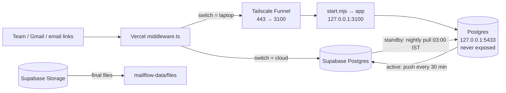

# MailFlow laptop server

MailFlow runs on **one server at a time**: the cloud (Vercel + Supabase) or this Windows laptop. The switch is the `SystemState` row in the cloud database. You change it in **Settings → Server** (`lib/system/serverState.ts`). Vercel always stays the public front door, so these never change:

- the address the team uses (https://mailflowbymasai.vercel.app);
- Google sign-in;
- the unsubscribe and tracking links in sent emails.



## Roles

`start.mjs` reads the switch every 15 seconds and reports a heartbeat. Its role follows the switch:

- **Standby (MailFlow on the cloud, the normal case).** Only the database runs here, and nothing is written to the cloud. The laptop does four things:
  - pulls a full copy of the cloud database every night at 03:00 IST, and on start-up if the last copy is over a day old;
  - archives finished files (below);
  - answers file requests with a small standby file server;
  - watches cloud Recruiter Bulk Sends (below);
  - sends the Recruiter Bulk Sends marked "Send from the laptop" (below), straight on the cloud database.
- **Active (MailFlow on the laptop).**
  - Runs the app on `127.0.0.1:3100` and every scheduled job.
  - Pushes a full copy to the cloud every 30 minutes, so the cloud is never more than 30 minutes behind.
  - Every minute it loads `/api/ping` through the public address (Vercel → Funnel → here). If that fails, it switches the Funnel entry for 443 → 3100 off and on again, at most every 10 minutes.
  - If the public address stays unreachable for **10 minutes**, it hands MailFlow back to the cloud by itself.
- **Handover.**
  1. When someone switches in Settings → Server, everyone sees "MailFlow is switching servers".
  2. After a 30-second grace, the active database is copied to the other one (`copy-db.mjs`: one transaction, row counts checked, never copies `SystemState` or the migration history).
  3. Then the switch flips.
- **Cloud safety moves.** A switch to the laptop that hasn't finished in 5 minutes is cancelled. A switch to the cloud is completed without the laptop after 10 minutes.

Without `mailflow-data\supabase.env` there is no switch, and the laptop is always the active server.

## Where things live

| What | Where |
| --- | --- |
| The app being served | `C:\Users\abhis\mailflow-live`, a git worktree of this repo. Development in `code\mailflow` never disturbs it. |
| Database, settings, logs, backups, files | `C:\Users\abhis\mailflow-data`, overridden with `MAILFLOW_DATA`. |
| App secrets | `mailflow-data\app.env` (includes `CRON_SECRET` and `LAPTOP_PUBLIC_URL`). Private: never commit or share it. |
| Cloud connection for the switch, copies and file archive | `mailflow-data\supabase.env` (its `SUPABASE_DATABASE_URL` becomes the app's `CONTROL_DATABASE_URL`). Private. |
| Database password | `mailflow-data\db.json` |
| Logs | `mailflow-data\logs\server.log` (supervisor, jobs, watchdog) and `app.log` (the app) |
| Nightly backups | `mailflow-data\backups\YYYY-MM-DD\*.csv.gz`. Every table, taken at 03:00 IST (or as soon as the laptop is on if the last one is over a day old). The last 7 are kept. |
| Pre-pull backups | `mailflow-data\backups\pre-pull-*`. The laptop's own data is backed up before anything is copied into it. The last 5 are kept. |
| Archived files | `mailflow-data\files` |
| Build markers | `mailflow-data\built-commit.txt`, `deps-hash.txt` |

## What `start.mjs` does

1. Starts Postgres from `./node_modules` (embedded, no installer), listening on 127.0.0.1 only.
2. Applies new migrations (`prisma migrate deploy`).
3. Runs `npm install` when `package-lock.json` changed since the last start, so a version that adds a library also builds here.
4. Rebuilds the app when the git commit differs from the last build, so the laptop never runs an older MailFlow than the cloud.
5. Follows the switch (above). While active, it runs the app, restarts it if it stops unexpectedly, and runs these jobs:

| Job | When (laptop, UTC) |
| --- | --- |
| `send-queue` (campaigns, Quick Send) | every minute |
| `recruiter-send` (Recruiter Bulk Send) | every minute |
| `gmail-sync`, `follow-ups`, `sheets-sync` | every 15 minutes |
| `scheduled-send`, `scheduled-replies` | 00:00 |
| `weekly-report` | Mondays 03:30 (09:00 IST) |
| `sla-check` | 08:00 |
| `signing-reminders` | 09:00 |
| `housekeeping` | 20:30 (2 AM IST) |
| `daily-digest`, the 8 PM IST daily report | 14:35 (20:05 IST). The route skips weekends and a day already sent. |

Vercel's own crons are not forwarded to the laptop (`middleware.ts` skips `/api/cron/*`). When the cloud is active, GitHub Actions and the Vercel daily crons run these instead (see `ARCHITECTURE.md` §11).

**After the laptop has been off**, overdue work runs as soon as it is back:
- queued emails carry on sending;
- half-sent campaign emails are checked against Gmail's Sent folder, so nothing goes out twice;
- daily jobs missed by less than 12 hours still run.

## Watchdog for cloud sends (standby)

Every 2 minutes on standby, the laptop looks in the **cloud database** for a Recruiter Bulk Send that is `SENDING` but hasn't sent or claimed anything for its pause + 75 seconds. That is usually a dropped hand-over between sender runs. Only when it finds one does it call the cloud's `/api/cron/recruiter-watchdog` to restart it. Checking the database first means no Vercel call at all while nothing is stuck, which matters under Vercel Hobby's CPU limits.

## Send from the laptop (Recruiter Bulk Send, standby)

To save Vercel's monthly "Fluid Active CPU" (Hobby: 4 hours), a Recruiter Bulk Send can be started with **Send from: This laptop** (step 7 of the send page). This is **not** a server switch: MailFlow stays on the cloud, nothing is copied and nobody sees "switching servers". Only that send's emails go out from here.

- While the laptop is on **standby**, `start.mjs` runs `recruiter-runner.ts` as a child process (`node --import tsx laptop-server/recruiter-runner.ts`, log: `logs\recruiter-runner.log`). It connects to the **cloud** database (the direct link, `SUPABASE_DIRECT_URL` from `supabase.env` with 5 connections, never the laptop's own Postgres; the transaction pooler on port 6543 with one connection made every query ~175 ms and planning one round take 10 s, so a send crawled at ~11 emails a minute) and runs the app's own sender (`lib/recruiterSend/worker.ts`, the same claims, pauses, limits and Gmail code) for sends marked `runOn = 'laptop'` only. Runs last up to 5 minutes and go round after round (no Vercel 60 s limit), one email per mailbox per round and every mailbox in each round; each mailbox still waits its own pause between emails. One log line per round shows how long planning and sending took. Secrets (`ENCRYPTION_KEY`, Google client, `SUPABASE_*` for a video) come from `app.env`.
- Vercel's sender (cron, dispatch, watchdog, hand-overs) skips those sends. If the laptop's heartbeat is **silent for 10 minutes**, the cloud takes the send over by itself (`runOn` → `cloud`, `runOnChangedAt` set, audit entry `RECRUITER_SEND_MOVED_TO_CLOUD`); the page shows "Moved to the cloud — the laptop went offline". Messages are claimed before they go out, so none is sent twice; one the laptop left half-sent is marked "check the Sent folder" instead of being re-sent.
- The choice is offered only while the laptop is online. When MailFlow is already **active** on the laptop, the page says "Already running on the laptop" and the app here sends everything itself (`MAILFLOW_SERVER=laptop`); the runner is stopped while active and before the copy of a switch to the laptop.
- When a laptop send finishes it is simply COMPLETED; there is nothing to switch back.

Needs nothing extra on the laptop beyond what it already has: `tsx` comes with the app's packages (`npm install --include=dev`, done by `start.mjs` when `package-lock.json` changes), and the new code is picked up the usual way (`git checkout --detach master` in `mailflow-live`, then `restart.request`). Deploy the cloud first so the database has the `runOn` column.

## File archive

Signing attachments and signed PDFs live in Supabase Storage (bucket `mailflow-files`) while a document is in progress. About every 6 hours (first run a minute after start), the laptop handles each final file:

1. downloads it;
2. checks it;
3. keeps it under `mailflow-data\files`;
4. deletes the cloud copy;
5. switches its reference to `archive:`.

This keeps Supabase within its free plan. The cloud fetches archived files from the laptop through signed links that last 5 minutes. On standby the app isn't running, so a small file server answers on the app's port instead.

## What keeps it running

- **`install.mjs`** adds `MailFlow server.vbs` to the Windows Startup folder. The server starts with no window whenever you sign in, and starts again a minute after it ever stops. Only one copy ever runs (`server.lock`).
- **Tailscale** runs as a Windows service, and its Funnel setting survives restarts.
- **Keep Windows awake:** set Settings → System → Power → "When plugged in, sleep after: **Never**".

## Everyday commands

Run these from `C:\Users\abhis\mailflow-live\laptop-server`:

```bash
node start.mjs                 # start by hand (exits at once if already running)
node install.mjs               # start automatically at sign-in
node install.mjs --remove      # stop starting automatically
node copy-db.mjs <fromUrl> <toUrl>   # copy every table from one database to another (all or nothing)
```

**To ship a code change to the laptop:** push it on `master`, then run this in `C:\Users\abhis\mailflow-live`:

```bash
git checkout --detach master
```

Then create the file `mailflow-data\restart.request`. The server stops cleanly, app and database included. The Startup script starts it again within a minute, and on start it installs changed packages and rebuilds for the new commit by itself.

`neon-export.mjs` and `neon-import.mjs` are one-time tools from the move off the old Neon database. They are kept for reference and are not used day to day.

## If something goes wrong

- **Postgres exits with code `3221225781`:** the Microsoft Visual C++ runtime is missing. `start.mjs` copies it from `mailflow-data\runtime`. Installing "Microsoft Visual C++ Redistributable (x64)" from Microsoft also fixes it for good.
- **The site shows "MailFlow is offline for a moment"** (laptop active):
  1. Check the laptop is on and online.
  2. Run `tailscale funnel status`.
  3. Read `logs\server.log`.

  If it stays offline, MailFlow moves to the cloud by itself after 10 minutes.
- **"LAPTOP_PUBLIC_URL not set in app.env!"** in the log: the cloud can't forward to this laptop until it is set.
